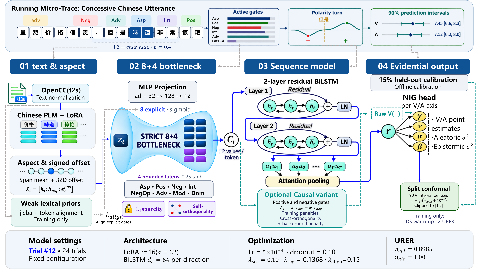

# Concept-BiLSTM-URER & Concept-BiLSTM-Causal

[](LICENSE)
[](pyproject.toml)
[](requirements.txt)

Official implementation and reproduction suite for:

> **Concept-Grounded Evidential Regression for Trustworthy Anti-Collapse Chinese Dimensional Sentiment Analysis**

This repository contains the complete model architecture (`Concept-BiLSTM-URER` and `Concept-BiLSTM-Causal`), BoTorch `qLogEHVI` multi-objective hyperparameter search pipeline, leakage-audited Chinese affective benchmark splits, statistical/counterfactual audit scripts, and reproducible figure generators.

<p align="center">
  
</p>
<p align="center">
  <sub><strong>Overview:</strong> End-to-end pipeline of <code>Concept-BiLSTM-URER</code> and its causal-orthogonality variant (<code>Concept-BiLSTM-Causal</code>), illustrating a running concessive Chinese utterance micro-trace, strict 8+4 concept bottleneck decoupling, a 2-layer residual BiLSTM sequence composer, evidential NIG parameter estimation, split-conformal calibration, and the Trial #12 MOBO configuration.</sub>
</p>

---

## Architecture Highlights

`Concept-BiLSTM-URER` decouples Chinese Transformer representation learning from affective reasoning and uncertainty quantification across four sequential stages:

1. **Text Normalization & Weak Concept Priors (`src/data/concepts.py`)**: OpenCC `t2s` Traditional-to-Simplified conversion paired with character span matching and `jieba` word segmentation extracts $K_{\text{exp}}=8$ weak lexical-rhetorical priors (*Aspect Focus, Positive Cue, Negative Cue, Intensity/Arousal, Negation Operator, Adversative Shift, Modality/Hedging, Domain Attribute*).
2. **Aspect-Relative Concept Bottleneck (`src/models/architectures.py`)**: A rank-16 LoRA-adapted Chinese PLM encodes token states fused with a masked aspect query $h_{\text{asp}}$ and signed relative distance embeddings $e_t^{\text{pos}} \in \mathbb{R}^{32}$ through a strict $8+4$ concept bottleneck without raw PLM skip connections.
3. **In-Bottleneck Residual BiLSTM & Causal Variant (`src/models/architectures.py`, `src/models/losses.py`)**: A 2-layer LayerNorm residual BiLSTM ($d_h=64$ per direction) composes sequential rhetorical shifts strictly over concept gates; `Concept-BiLSTM-Causal` adds a monotonic direct Valence path ($\Delta_V$), cross-channel orthogonality ($\mathcal{L}_{\text{cross}}$), and background suppression ($\mathcal{L}_{\text{bg}}$).
4. **Evidential NIG Head, URER, & Split Conformal Calibration (`src/models/losses.py`, `src/train_eval.py`)**: Normal-Inverse-Gamma regression predicts decomposed aleatoric ($\sigma_{\text{ale}}^2$) and epistemic ($\sigma_{\text{epi}}^2$) variance under Label Distribution Smoothing (LDS), dynamic Uncertainty-Reweighted Extreme Regression (URER), batch CCC regularization, and studentized split-conformal prediction intervals.

---

## Repository Structure

```text
concept-bilstm-urer/
├── .github/workflows/ci.yml       # Syntax, dataset split, and hygiene CI workflow
├── assets/
│   └── fig1_architecture.png      # End-to-end architecture diagram
├── configs/
│   ├── default.yaml               # Dataset, backbone, training, and MOBO settings
│   └── trial12_knee.json          # Selected 24-trial BoTorch qLogEHVI Pareto-knee config
├── data/
│   ├── README.md                  # Benchmark schemas, sources, and rebuild guide
│   └── processed/                 # Leakage-checked unified Parquet benchmark splits
├── src/
│   ├── data/                      # Concept prior extraction & LDS dataset loaders
│   ├── models/                    # Concept-BiLSTM-URER/Causal & NIG/URER/CCC losses
│   ├── explain/                   # Deletion faithfulness, IG, & counterfactual audits
│   ├── utils/                     # RMSE, CCC, Tail20, StdRatio, PICP/Winkler, OOD AUROC
│   ├── train_eval.py              # Unified multi-seed training & conformal evaluation
│   ├── mobo_search.py             # BoTorch qLogEHVI multi-objective search & fANOVA
│   ├── eval_suite.py              # Statistical testing, zero-shot probes, & 3B LLM eval
│   └── pub_figures.py             # Composite multi-panel figure generator (outputs/figures)
├── scripts/
│   ├── audit_and_prepare_data.py  # Optional: rebuild data/processed/ from raw corpora
│   ├── run_full_research.py       # End-to-end resumable pipeline orchestrator
│   └── verify_reproduction.py     # Dataset integrity, hygiene, & post-run output verifier
├── CONTRIBUTING.md
├── pyproject.toml
├── requirements.txt
└── LICENSE
```

---

## Installation

Python 3.10+ and an NVIDIA GPU (tested on a single RTX 4090 24 GB) are recommended for full training reproduction.

```bash
python -m venv .venv
# Linux/macOS: source .venv/bin/activate
# Windows PowerShell: .\.venv\Scripts\Activate.ps1
pip install -r requirements.txt
```

> **Note:** On mainland China networks, set `HF_ENDPOINT=https://hf-mirror.com` before downloading HuggingFace backbones (`hfl/chinese-macbert-base`, `hfl/chinese-roberta-wwm-ext`, `IDEA-CCNL/Erlangshen-DeBERTa-v2-97M-Chinese`, `Qwen/Qwen2.5-3B-Instruct`).

---

## Quick Verification (Offline)

Validate syntax, zero-leakage dataset splits (`36,723` instances across DimABSA 2026 Chinese, BRIGHTER-CHN, and LogicSentiment-Zho), hyperparameter configs, and repository hygiene locally:

```bash
python -m compileall -q src scripts
python scripts/verify_reproduction.py
```

---

## End-to-End Reproduction

All training logs, checkpoints, statistical CSVs, and generated figures are written to `outputs/` at runtime:

```bash
# Optional: rebuild processed splits from raw corpora placed in data/raw/
python scripts/audit_and_prepare_data.py

# Full sequential pipeline (MOBO -> Main -> Ablations -> Backbones -> Causal Patch -> Probes -> LLM -> Stats & Figures)
python scripts/run_full_research.py --phase all --no-skip
```

Or run individual experiment stages:

| Experiment Stage | Command |
| :--- | :--- |
| **Multi-Objective BO (`qLogEHVI`, 24 trials) & `fANOVA`** | `python scripts/run_full_research.py --phase mobo --mobo-trials 24 --no-skip` |
| **Main 5-Seed Benchmarks** (`DimABSA`, `BRIGHTER-CHN`, `LogicSentiment`) | `python scripts/run_full_research.py --phase main --no-skip` |
| **Ablations, Label Efficiency (`25%`/`50%`), & OOD (`Rest+Lap -> Fin`)** | `python scripts/run_full_research.py --phase ablations --no-skip` |
| **Cross-Backbone Portability** (`RoBERTa-wwm-ext`, `DeBERTa-v2-97M`) | `python scripts/run_full_research.py --phase secondary_backbones --no-skip` |
| **`Concept-BiLSTM-Causal` Patch & Counterfactual Audit** | `python scripts/run_full_research.py --phase mechanism_patch --no-skip` |
| **Zero-Shot Rhetorical/OOD Probes & Case Audits** | `python scripts/run_full_research.py --phase probe` |
| **Zero-Shot `Qwen2.5-3B-Instruct` Baseline** | `python scripts/run_full_research.py --phase llm` |
| **Paired Wilcoxon Tests & Summary Figures** | `python scripts/run_full_research.py --phase stats_plot` |
| **Post-Run Numerical Audit** | `python scripts/verify_reproduction.py --with-outputs` |

> **Tip:** To skip the 24-trial MOBO search and train directly with the fixed Trial #12 configuration, omit `--phase mobo` (when `outputs/mobo_zho_rest/mobo_best_config.json` is absent, `run_full_research.py` automatically loads `configs/trial12_knee.json`).

---

## License

- Source code and configurations are released under the **MIT License** ([LICENSE](LICENSE)).
- Processed benchmark splits under `data/processed/` correspond to `DimABSA 2026`, `BRIGHTER-CHN`, and `LogicSentiment-Zho` and remain subject to their upstream licenses (see [data/README.md](data/README.md)).
